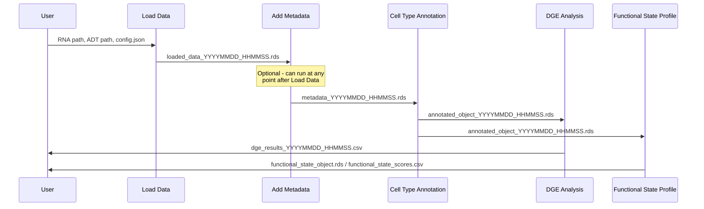

# CITE-seq

The CITE-seq solution provides Smart Functions and Connectors to execute single-cell multi-modal (RNA + ADT) T cell analysis workflows on the GenAIz Orchestration environment.

<!-- TOC -->
* [CITE-seq](#cite-seq)
  * [Workflows](#workflows)
    * [CITE-seq Pipeline](#cite-seq-pipeline)
      * [User-Provided Parameters](#user-provided-parameters)
    * [Single-Function Workflows](#single-function-workflows)
  * [Smart Functions](#smart-functions)
    * [load-data](#load_data)
    * [add-metadata](#add_metadata)
    * [cell-type-annotation](#cell_type_annotation)
    * [differential-gene-expression-analysis](#differential_gene_expression_analysis)
    * [functional-state-profile](#functional_state_profile)
  * [Contributing](#contributing)
  * [License](#license)
<!-- TOC -->

## Workflows

### CITE-seq Pipeline

#### User-Provided Parameters

| Module | Parameter | Type | Where? |
|---|---|---|---|
| load_data | `rna_path` | STRING | configs/config.json |
| load_data | `adt_path` | STRING | configs/config.json |
| load_data | `project_name` | STRING | configs/config.json |
| add_metadata | `input_rds` | STRING | configs/config.json |
| add_metadata | `metadata_file` | STRING | configs/config.json |
| add_metadata | `object_key` | STRING | configs/config.json |
| add_metadata | `metadata_key` | STRING | configs/config.json |
| cell_type_annotation | `method` | STRING (`"SingleR"`, `"STCAT"`, `"both"`) | configs/config.json |
| cell_type_annotation | `reference` | STRING (`"monaco"`, `"hpca"`, etc.) | configs/config.json |
| differential_gene_expression_analysis | `test_use` | STRING (`"MAST"`, `"wilcox"`, `"bimod"`, `"roc"`, `"t"`, `"negbinom"`, `"poisson"`, `"LR"`, `"DESeq2"`, `"limma"`, `"edgeR"`) | configs/config.json |
| differential_gene_expression_analysis | `pseudobulking` | BOOLEAN | configs/config.json |
| functional_state_profile | `marker_json_path` | STRING | configs/config.json |
| functional_state_profile | `use_core_only` | BOOLEAN | configs/config.json |

### Single-Function Workflows

A workflow is the only unit the platform can start, so each smart function also
ships as a single-node workflow. Use these to run one step on its own - for
example re-annotating an existing object without re-loading the data - by
POSTing an `algorithmRuns` request with the solution handle
`cite-seq` and the workflow handle below.

| Workflow handle | Runs |
|---|---|
| `cite-seq-pipeline` | The full pipeline (all five smart functions) |
| `load-data-only` | Load Data |
| `add-metadata-only` | Add Metadata |
| `cell-type-annotation-only` | Cell Type Annotation |
| `differential-gene-expression-only` | DGE Analysis |
| `functional-state-profile-only` | Functional State Profile |

Each single-node workflow takes its input from the same input port as the
corresponding node in the full pipeline, so the configs are unchanged.

When composing custom (dynamic) workflows, every node can feed a
downstream node: load-data, add-metadata, cell-type-annotation and
functional-state-profile output the Seurat `.rds` they produced, and
differential gene expression - whose *results* are a CSV table - passes
its input Seurat object through unchanged (`dge_passthrough_*.rds`) so
that chaining out of it works too. A node downstream of DGE receives the
same object DGE analyzed; the DGE results travel only in the CSV.

## Smart Functions

### [load_data](load_data/README.md)

Loads one pre-assembled multi-modal object into a Seurat object. Accepted inputs are a single `.rds` containing a Seurat object, an AnnData `.h5ad`, or a MuData `.h5mu` - each of which already carries RNA and ADT together, so there is no separate ADT path. Raw matrices (CSV, 10X `tar.gz`, plain `.h5`) and directories are rejected with `UNSUPPORTED_FORMAT`. For `.h5ad` files: maps layers faithfully with no normalization - an integer layer (`layers/counts`, `layers/raw`, `raw/X`) becomes `counts` and a non-integer `X` becomes `data` - extracts cell metadata (`obs`) and embeddings (`obsm`), and auto-detects embedded **ADT/protein data** via three patterns (AB\_ prefix interleaved in X, `uns/antibody_X`, or `obsm/protein`). Reading `.h5ad`/`.h5mu` needs an in-process Python backend; if `h5py`/`anndata` cannot be imported the run stops with `H5AD_PYTHON_BACKEND_UNAVAILABLE` rather than silently dropping the protein data. Ensembl IDs are converted to gene symbols via `AnnotationDbi`. All output filenames are automatically timestamped for compliance.

### [add_metadata](add_metadata/README.md)

Integrates external sample/patient metadata (Excel, CSV, TSV) into a Seurat object via left join on a specified key column. This is a standalone module that can run at **any point** in the pipeline after data loading - not just immediately after `load_data`. Supports match status tracking, metadata backup, and join statistics.

### [cell_type_annotation](cell_type_annotation/README.md)

Annotates cell types in a processed Seurat object using SingleR (pseudo-bulk aggregation, memory-efficient on 500k+ cell datasets) and/or STCAT (Python-based immune cell type annotation). The STCAT workflow uses BPCells disk-to-disk h5ad writing (no `dgCMatrix` in R RAM) and a sequential CD4/CD8 subtyping approach (eliminates the ~3x fork-copy OOM).

With `method: "both"` the two run as one coordinated sequence: SingleR first (cluster-level main + fine, then a chunked per-cell fine refinement) -> vocabulary rescue for types the reference cannot name (platelets, erythrocytes) from canonical markers -> a **T cell gate** that sends only cells SingleR labels as T cells to STCAT, on a batch-corrected T-subset re-embedding -> SingleR fine labels as fallback for non-gated, `"None T"` and unreturned cells -> harmonization of fallback labels onto the STCAT vocabulary. The final `Uncertainty_score` doubles as a provenance flag (non-`NA` = STCAT, `NA` = SingleR). All output filenames are automatically timestamped for compliance.

### [differential_gene_expression_analysis](differential_gene_expression_analysis/README.md)

Performs differential gene expression analysis supporting both Seurat-native tests (MAST, wilcox, bimod, roc, t, negbinom, poisson, LR) and pseudobulk methods (DESeq2, limma, edgeR) with stratified or interaction design strategies. Handles repeated-measures designs via `duplicateCorrelation()`.

### [functional_state_profile](functional_state_profile/README.md)

Classifies T cell functional states (exhaustion, memory, naive-like, cytotoxicity, proliferation, etc.) using rank-based UCell gene signature scoring (Mann-Whitney U statistic). Produces per-cell scores for every state in the marker JSON (15 RNA states, 8 ADT surface states) plus a dominant state assignment with an optional `min_score` -> `unassigned` threshold and a top-vs-runner-up margin column. Robust to dataset composition and memory-efficient on sparse matrices.

## Pipeline Architecture

The **alternate_workflow orchestrator** uses a **dispatch-loop architecture** - each pipeline step is a self-contained function registered in a dispatch table. The orchestrator iterates over `config.execution.steps` in the user-specified order, so `add_metadata` can appear at any position after `load_data`.

**Batch effect detection and correction** is embedded in the `process_seurat` step:
- **RNA**: silhouette width on the PCA embedding -> Harmony correction (the `lisi` dependency has been removed)
- **ADT detection**: per-protein Wasserstein distance on CLR-normalized data **plus** a kBET rejection rate on a provisional ADT PCA - the second view is what predicts whether WNN clustering will split by batch
- **ADT correction**: `batch.adt_correction_method` selects `"harmony"` (default - corrects the `apca` embedding into `harmony.adt` for WNN/UMAP, leaving marker values untouched), `"adtnorm"` (corrects the CLR `data` layer), or `"none"`
- A **guardrail** re-measures mixing after correction and adopts it only if the kBET rejection rate improves by at least `batch.adt_guardrail_min_improvement`; otherwise the correction is reverted. Outcomes are recorded in `misc$batch_qc`
- Post-correction validation re-runs detection metrics to verify improvement
- Controlled via `batch` section in config (`"auto"`, `true`, or `false`)

## Contributing

To contribute to this project, please follow these steps:

1. Fork this repository to your personal account.
2. Create a new branch for your feature or bug fix.
3. Commit and push changes to your forked repository.
4. Open a Pull Request (PR) to allow merging into the upstream repository.

